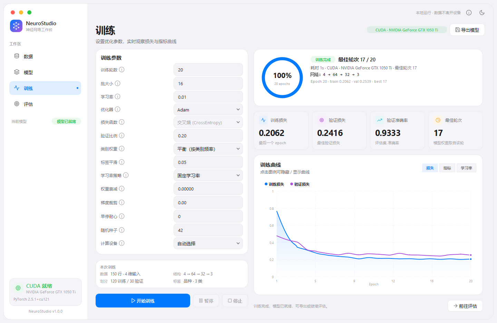
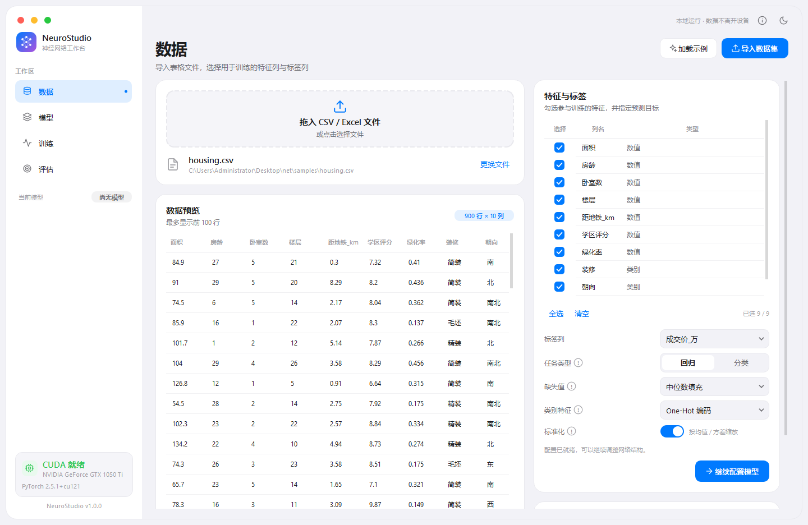
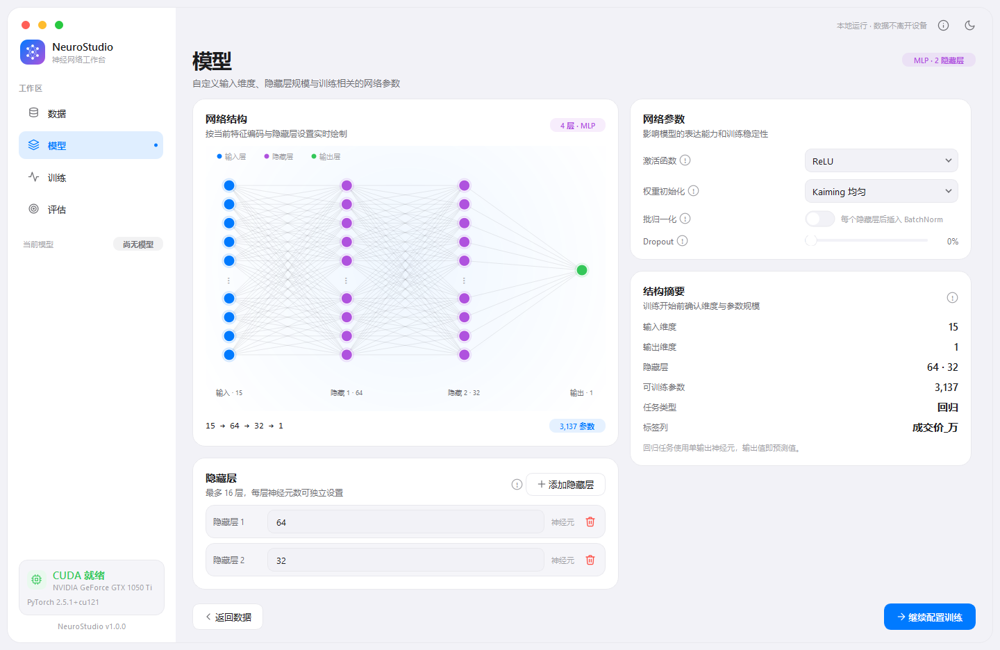
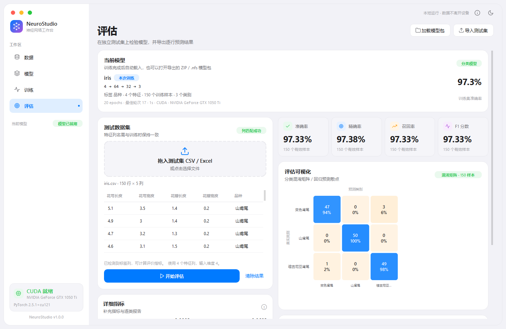
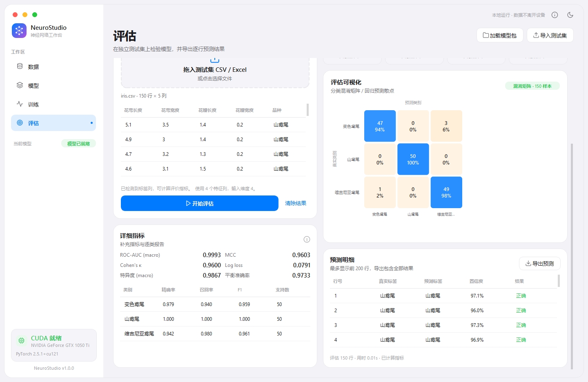
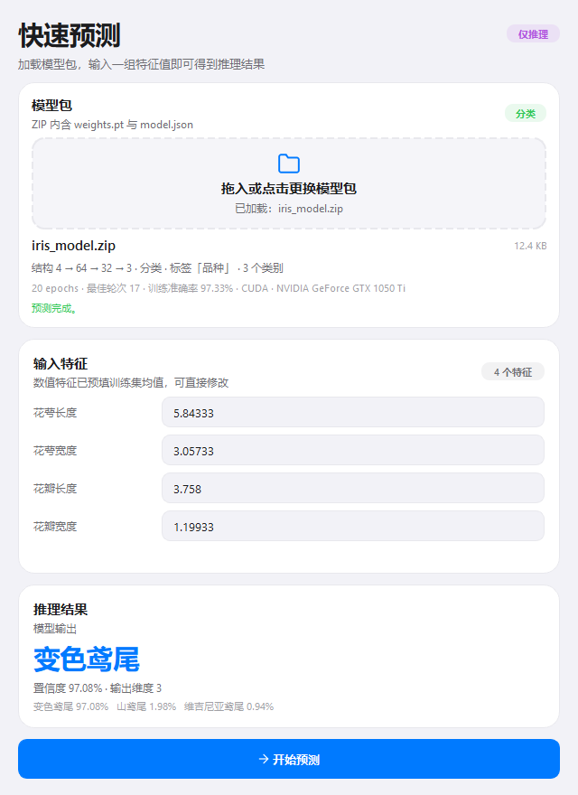
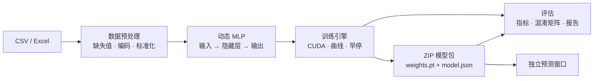

<div align="center">

# NeuroStudio

**用 iOS 的审美，做一张真正能跑起来的神经网络工作台。**

从 CSV / Excel 到可部署模型：选择特征与标签，自由搭建多层感知机，在 CUDA 上训练，
实时观察曲线，完成独立测试评估，并导出包含权重与结构的 ZIP 模型包。

<br>


[界面预览](#界面预览) · [功能](#功能) · [快速开始](#快速开始) · [训练参数](#训练参数) · [评价指标](#评价指标) · [模型包](#模型包) · [参数说明](docs/parameters.html)

</div>

<p align="center">
  
</p>

## 为什么是 NeuroStudio？

很多神经网络项目需要写脚本、记命令、手工保存权重。NeuroStudio 把这些步骤放进一个统一的可视化工作台：

| 你想要的 | NeuroStudio 提供 |
| --- | --- |
| 快速验证表格数据 | 导入 CSV / TSV / Excel，自动识别数值列与类别列，选择特征与标签 |
| 自由设计网络 | 输入维度、隐藏层数量、每层宽度、激活函数、Dropout、BatchNorm 全部可调，结构图实时更新 |
| 硬件加速 | 自动检测 CUDA，GTX 10 系列及更新显卡可用；也可切换 CPU |
| 观察训练过程 | 后台线程训练，损失 / 指标 / 学习率曲线实时更新，支持暂停、继续、停止 |
| 得到可信评估 | 独立测试集、混淆矩阵、预测散点、AUC / MCC / κ / Log loss 与逐类报告 |
| 保存并复用 | 导出 `weights.pt` + `model.json` 的 ZIP；测试页和独立预测窗口都能直接加载 |
| 理解参数 | 参数旁「!」打开 HTML 说明，包含含义、公式与使用建议 |

## 界面预览

<table>
<tr>
<td width="50%" align="center"><b>数据与特征</b><br></td>
<td width="50%" align="center"><b>网络结构</b><br></td>
</tr>
<tr>
<td align="center"><b>训练与实时曲线</b><br></td>
<td align="center"><b>测试集评估</b><br></td>
</tr>
</table>

<p align="center">
  <br>
  <sub>详细指标与逐类报告</sub>
</p>

<p align="center">
  <br>
  <sub>独立预测窗口：加载 ZIP，输入特征，直接得到推理结果</sub>
</p>

## 功能

| 模块 | 能力 |
| --- | --- |
| **数据** | CSV / TSV / TXT / Excel；缺失值均值 / 中位数 / 众数填充或删除；数值标准化；类别特征 One-Hot / 序数编码；自动推断回归 / 分类任务 |
| **网络** | 输入维度随特征编码自动计算；隐藏层 1–16 层、每层 1–8192 个神经元；输出维度按标签自动对齐；8 种激活函数、5 种初始化、Dropout、BatchNorm；实时结构图与参数量 |
| **训练** | 后台线程；epochs、batch size、学习率、优化器、损失、类别权重、标签平滑、验证比例、学习率策略、权重衰减、梯度裁剪、早停、随机种子、设备；损失 / 指标 / 学习率三类曲线 |
| **评估** | 独立测试集；分类：Accuracy、macro Precision / Recall / F1、ROC-AUC、MCC、Cohen's κ、Log loss、特异度、平衡准确率、混淆矩阵、逐类报告；回归：R²、RMSE、MAE、MAPE、MedAE、解释方差、平均偏差、预测散点 |
| **模型包** | ZIP（`weights.pt` + `model.json`），保存结构、预处理、训练参数、曲线、最佳轮次与指标；兼容旧版 `.nfs` |
| **独立推理** | `tests/app` 小窗口只加载模型包，按训练特征自动生成输入表单，输出分类概率或回归数值 |
| **帮助** | 参数旁「!」HTML 说明；完整文档 `docs/parameters.html`；支持在浏览器打开 |
| **界面** | 无边框圆角窗口、深浅色主题、自绘 iOS 风格控件与图表、键盘快捷键 |

## 快速开始

### 环境要求

- Windows 10 / 11（当前验证环境）
- Python 3.10
- NVIDIA GPU 可选；有 CUDA 时自动加速
- 已验证：PyTorch 2.5.1 + CUDA 12.1、PySide6 6.8.3、GTX 1050 Ti

### 安装

```bash
git clone https://github.com/moyulyy/Neural-Network-Studio.git
cd Neural-Network-Studio

conda create -n neurostudio python=3.10 -y
conda activate neurostudio

# CUDA 12.1 版 PyTorch（无 NVIDIA GPU 可安装 CPU 版 torch）
python -m pip install torch==2.5.1 --index-url https://download.pytorch.org/whl/cu121

# PySide6 未被部分国内镜像收录，使用官方源
python -m pip install PySide6==6.8.3 --index-url https://pypi.org/simple

python -m pip install -r requirements.txt
python run.py
```

也可以直接运行：

```bat
setup_env.bat   :: 创建环境并安装依赖
run.bat         :: 启动应用
```

### 验证 CUDA

```python
import torch
print(torch.__version__, torch.cuda.is_available(), torch.cuda.get_device_name(0))
```

## 使用流程

1. **数据**：拖入或选择文件。默认最后一列为标签、其余列为特征，自动跳过 ID 与常量列；可手动勾选特征、切换标签与任务类型。
2. **模型**：增删隐藏层、设置每层神经元数，选择激活函数、初始化、Dropout 与 BatchNorm；右侧查看输入 / 输出维度与参数量。
3. **训练**：设置训练参数后开始；曲线实时更新，可随时暂停或停止；停止时自动恢复验证损失最低的权重。
4. **评估**：加载独立测试集，自动校验特征列；查看指标、混淆矩阵 / 散点、详细指标与逐类报告。
5. **导出与推理**：导出 ZIP 模型包，可在测试页重新加载，或交给 `tests/app` 独立预测窗口。

快捷键：`Ctrl+1~4` 切换页面，`Ctrl+O` 导入数据，`Ctrl+S` 导出模型，`Ctrl+D` 切换深浅色。

## 训练参数

| 参数 | 说明 |
| --- | --- |
| 训练轮数 | 1 – 1,000,000 |
| 批大小 | 1 – 65,536 |
| 学习率 | 支持小数与科学计数法（如 `1e-4`） |
| 优化器 | Adam / AdamW / SGD（momentum 0.9）/ RMSprop |
| 损失函数 | 回归：MSE / MAE / Huber / Smooth L1；分类：交叉熵 |
| 类别权重 | 分类任务可选「平衡」，按 `N/(K·N_c)` 给少数类加权 |
| 标签平滑 | 0 – 0.5，`target = (1−ε)·onehot + ε/K` |
| 验证比例 | 0 – 0.5，分类任务分层抽样 |
| 学习率策略 | 固定 / 余弦退火 / 阶梯衰减 |
| 权重衰减 | L2 正则 |
| 梯度裁剪 | 按全局范数裁剪，0 表示关闭 |
| 早停耐心 | 验证损失连续 N 轮未改善后停止，0 表示关闭 |
| 随机种子 | 控制初始化、打乱与 Dropout |
| 计算设备 | 自动 / CUDA / CPU |

网络结构方面，输出维度由标签自动决定：分类 = 类别数，回归 = 1；输入维度由特征和编码方式决定；隐藏层完全自定义。

## 评价指标

**回归**

| 指标 | 含义 |
| --- | --- |
| R² | 拟合优度，越接近 1 越好 |
| RMSE / MAE | 均方根误差 / 平均绝对误差 |
| MAPE | 平均绝对百分比误差 |
| MedAE | 绝对误差中位数，对异常值稳健 |
| 解释方差 / 平均偏差 | 误差方差解释比例与预测平均偏移 |

**分类**

| 指标 | 含义 |
| --- | --- |
| Accuracy / Precision / Recall / F1 | 准确率与 macro 精确率 / 召回率 / F1 |
| ROC-AUC | 二分类直接计算；多分类 one-vs-rest 宏平均 |
| MCC / Cohen's κ | 类别不平衡下更稳健的一致性指标 |
| Log loss | 概率校准与置信度质量 |
| 特异度 / 平衡准确率 | 各类别负类识别能力 / macro 召回 |
| 混淆矩阵 / 逐类报告 | 真实 vs 预测分布与每类精确率、召回率、F1、支持数 |

## 模型包

训练页「导出模型」（或 `Ctrl+S`）生成一个 ZIP：

```text
model.zip
├─ weights.pt     # PyTorch state_dict
└─ model.json     # 结构、预处理、训练参数/曲线/指标、数据集摘要
```

`model.json` 关键字段：

- `model_config`：输入维度、隐藏层、输出维度、激活函数、Dropout、BatchNorm、初始化
- `preprocessor`：特征列、编码方式、缺失值填充、均值 / 方差、类别字典、标签类别
- `training`：训练参数、完整曲线、最佳轮次、耗时、设备、训练 / 验证集大小、最终指标
- `dataset`：数据来源、样本数、标签列、编码后特征、类别列表
- `created_at` / `app` / `weights_file`

读取示例：

```python
import io, json, zipfile, torch

with zipfile.ZipFile("model.zip") as zf:
    meta = json.loads(zf.read("model.json").decode("utf-8"))
    state = torch.load(io.BytesIO(zf.read("weights.pt")), map_location="cpu", weights_only=True)

print(meta["model_config"])
print(meta["training"]["final_metrics"])
```

> 旧的 `.nfs`（`torch.save` 整包）仍可加载。请只加载自己或可信来源的模型包；ZIP 权重以 `weights_only=True` 读取。

## 独立推理窗口

`tests/app/` 是一个仅用于推理的小窗口，不包含数据导入和训练功能。

```bash
conda activate neurostudio
python tests/app/predict_app.py
# 或直接打开模型
python tests/app/predict_app.py path/to/model.zip
```

也可以双击 `tests/app/run_predict.bat`，或把 ZIP 拖到 bat 上。

窗口会读取 `model.json` 自动生成特征输入：

- 数值特征预填训练集均值，可修改
- 类别特征提供训练时的类别下拉
- 回归输出数值；分类输出类别、置信度与各类概率

<p align="center">
  
</p>

## 参数帮助

数据、模型、训练页的关键参数旁都有「!」按钮，点击打开 HTML 说明并自动定位到对应小节；
标题栏右上角的信息按钮打开完整文档。弹窗内可选择「在浏览器中打开」。

文档：[`docs/parameters.html`](docs/parameters.html)

覆盖内容：激活函数、初始化、Dropout、BatchNorm、优化器、损失函数、类别权重、标签平滑、
学习率策略、权重衰减、梯度裁剪、早停、指标公式等。

## 架构



代码分为 `core`（数据、网络、训练、指标、持久化）与 `ui`（主题、控件、图表、页面）两层；
独立预测窗口只依赖 core 与 UI 基础控件，不加载训练页面。

## 项目结构

```text
net/
├─ run.py                        # 启动入口
├─ run.bat / setup_env.bat
├─ requirements.txt / environment.yml
├─ LICENSE
├─ docs/
│  ├─ parameters.html            # 参数说明
│  └─ images/                    # README 截图
├─ neurostudio/
│  ├─ state.py                   # 应用状态与预处理生命周期
│  ├─ core/
│  │  ├─ model.py                # 动态 MLP
│  │  ├─ data.py                 # 数据读取、编码、划分
│  │  ├─ trainer.py              # 训练循环、早停、类别权重
│  │  ├─ metrics.py              # 评价指标
│  │  └─ persistence.py          # ZIP / .nfs 模型包
│  └─ ui/
│     ├─ theme.py / icons.py     # iOS 设计系统
│     ├─ widgets.py / charts.py  # 通用控件与自绘图表
│     ├─ help.py                 # 「!」帮助弹窗
│     ├─ main_window.py
│     └─ pages/                  # 数据 / 模型 / 训练 / 评估
├─ samples/                      # 鸢尾花 / 房价 / 客户流失示例
└─ tests/
   ├─ test_core.py               # 核心测试
   └─ app/                       # 独立预测窗口
```

## 测试

```bash
conda activate neurostudio
python -m pytest tests -q
```

覆盖动态网络、数据预处理、指标、回归 / 分类训练、早停、类别权重、标签平滑、
AUC / MCC / κ / Log loss、ZIP 模型包与旧版兼容。当前测试集：**22 passed**。

## 常见问题

**CUDA 不可用？**  
确认安装的是 CUDA 版 PyTorch，并升级 NVIDIA 驱动；应用会自动回退到 CPU。

**PySide6 安装失败？**  
部分国内镜像未收录 PySide6，请使用官方源：`--index-url https://pypi.org/simple`。

**读取 Excel 失败？**  
安装 `openpyxl`（已包含在 `requirements.txt`）。

**BatchNorm 报错 “Expected more than 1 value per channel”？**  
训练器会跳过大小为 1 的批次；通常增大数据量或减小批大小即可。

**输出维度为什么不能手动设为任意值？**  
分类输出必须等于类别数，回归输出为 1，才能保证损失函数与标签张量对齐；输入与隐藏层完全自定义。

**中文列名或路径？**  
支持 UTF-8、UTF-8-SIG、GBK 编码的表格与中文路径。

## License

本项目采用 [MIT License](LICENSE)。

<br>

<div align="center">
<sub>如果 NeuroStudio 对你有帮助，欢迎 Star ⭐</sub>
</div>
